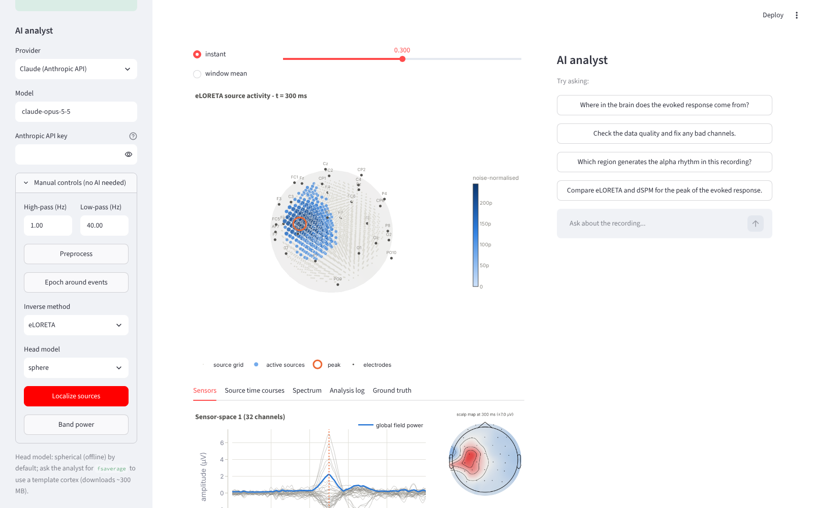

# 🧠 EEG Source Explorer

Interactive EEG source imaging with an **agentic AI analyst**. Upload an EEG
recording (or generate a synthetic one), ask *"where in the brain does this
activity come from?"*, and watch the agent preprocess the data, build a head
model, run an inverse solution with MNE-Python and light up a 3D brain view -
then explain what it found, with the caveats a careful neuroscientist would add.



## What it does

| Layer | What's inside |
|---|---|
| **Analysis pipeline** (`eeg_explorer/pipeline.py`) | Loading (FIF, EDF, BDF, EEGLAB, BrainVision, GDF, CNT), band-pass/notch filtering, transparent bad-channel detection + interpolation, average reference, epoching with rejection, head modelling, eLORETA / sLORETA / dSPM / MNE inverse solutions, spatially separated peak finding with region labels, Welch band power. |
| **Head models** | `sphere` - 3-layer spherical conductor fitted to the electrodes with a 10 mm volume grid. Fully offline, builds in about a second. `fsaverage` - MNE's template cortex with a BEM and Desikan-Killiany labels (downloads ~300 MB on first use). |
| **AI analyst** (`eeg_explorer/agent.py`, `tools.py`) | An agent that drives the pipeline through nine tools, interprets results and points the 3D viewer at what it is describing. Works with **Claude** (Anthropic API) or any **open-weight model** behind an OpenAI-compatible endpoint (Ollama, vLLM, LM Studio, llama.cpp). |
| **UI** (`app.py`) | Streamlit app: 3D source map with time/window scrubbing, sensor butterfly plot + scalp topography, source time courses, spectrum and band power, a full analysis log, and the chat panel showing every tool call the agent made. Manual controls let you run everything without an LLM. |
| **Synthetic demo** (`eeg_explorer/data.py`) | A 32-channel visuo-motor task with *known* sources (left sensorimotor evoked response, right occipital alpha burst) and a planted bad channel - so the agent can report true localisation error, which is impossible with real data. |

## Quick start

```bash
git clone <this repo>
cd eeg-source-explorer
python -m venv .venv && source .venv/bin/activate   # Windows: .venv\Scripts\activate
pip install -r requirements.txt
cp .env.example .env                                 # add your keys / endpoint
streamlit run app.py
```

Click **Generate synthetic demo**, then ask the analyst something like:

* *Where in the brain does the evoked response come from?*
* *Check the data quality and fix any bad channels.*
* *Which region generates the alpha rhythm?*
* *Compare eLORETA and dSPM for the peak of the evoked response - and how close is each to the ground truth?*

### Choosing a model

**Claude** - set `ANTHROPIC_API_KEY` (or paste it in the sidebar). Default model
is `claude-opus-5-5` with adaptive thinking; the reasoning summary is shown
in the chat under *💭 reasoning*. Server-side refusal fallbacks are enabled.

**Open-weight models** - run any tool-calling model locally and point the app at
it. With [Ollama](https://ollama.com):

```bash
ollama pull qwen2.5:14b          # or llama3.1:8b, mistral-nemo, gemma3:12b ...
ollama serve                      # exposes http://localhost:11434/v1
```

Pick *Open-weight model* in the sidebar (or set `OPEN_BASE_URL` / `OPEN_MODEL`
in `.env`). Any server that speaks the OpenAI chat-completions API with
function calling works the same way (vLLM: `http://host:8000/v1`, LM Studio:
`http://localhost:1234/v1`). Models of 14B parameters and up follow the
multi-step workflow reliably; smaller ones may need more explicit prompting.

## How the agent works

```
user question ──▶ LLM ──▶ tool call(s) ──▶ pipeline (MNE) ──▶ results JSON ──▶ LLM ──▶ answer
                   ▲                                                            │
                   └────────────── repeats until the model has what it needs ───┘
```

The tools (`describe_recording`, `preprocess_recording`, `epoch_recording`,
`localize_sources`, `find_peak_sources`, `compute_band_power`, `set_viewer`,
`compare_with_ground_truth`, `get_analysis_log`) are plain Python functions
with JSON schemas. Both backends run the same loop: send the conversation
plus tool definitions, execute whatever the model asks for, feed the results
back, repeat. Every call and its result is shown in the chat, so the analysis
is fully auditable; the *Analysis log* tab lists each step with parameters and
timing.

The system prompt encodes method knowledge the model should apply: eLORETA
has the lowest localisation error, dSPM is biased towards deep sources, the
spherical model is good to ~2 cm for superficial sources, distributed
inverses are blurry by construction, and so on.

## Accuracy

On the synthetic demo (sphere model, 10 mm grid, 32 channels, ~3 µV noise)
the evoked motor source is recovered within ~20 mm by eLORETA/sLORETA and
~40 mm by dSPM - consistent with what is expected from a spherical model.
`tests/test_pipeline.py` asserts these bounds.

## Development

```bash
pytest -q          # 18 tests; no network or API keys needed (LLM clients are faked)
```

```
eeg-source-explorer/
├── app.py                 Streamlit UI
├── eeg_explorer/
│   ├── pipeline.py        MNE analysis steps + AnalysisState
│   ├── data.py            file loading, synthetic demo
│   ├── tools.py           tool registry shared by all LLM backends
│   ├── agent.py           Anthropic + OpenAI-compatible agent loops
│   └── viz.py             Plotly / matplotlib figures
└── tests/
```

## Limitations and roadmap

* The spherical head model has no real anatomy; use `fsaverage` for cortical
  rendering and anatomical labels (needs the download). Individual MRI-based
  head models are not supported.
* Source estimates are distributed minimum-norm solutions; they show the most
  likely *region* of activity, not discrete dipoles.
* Ideas: beamformers (LCMV/DICS), time-frequency source imaging, exporting a
  PDF report written by the agent, batch analysis across subjects.

## Acknowledgements

Built on [MNE-Python](https://mne.tools). Grew out of the
[EEG-Source-Imaging-with-MNE-Python](https://github.com/berdakh/EEG-Source-Imaging-with-MNE-Python)
script collection.
